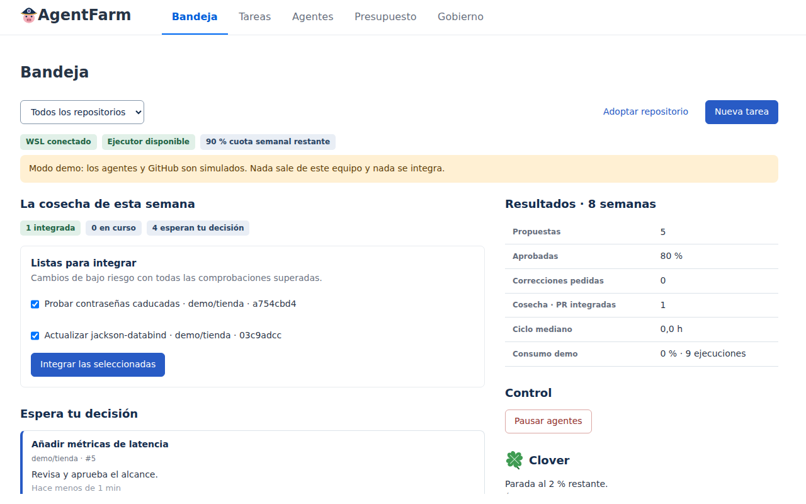

# AgentFarm

**Stop maintaining your repos.** Connect a farm of coding agents: they watch CI and dependencies,
propose fixes and bring you every change with its tests. **Nothing merges without your approval of
the exact commit.**



The panel is in Spanish for now; the full documentation is in the [Spanish README](README.md).

## Try it in a minute

```bash
git clone https://github.com/alejbormeg/AgentFarm.git && cd AgentFarm
./agentfarm demo
```

Agents and GitHub are simulated, and nothing leaves your machine. You need JDK 21, git and python3.

## How it works

1. **You adopt a repository.** The agents study it and propose its test commands, quality rules and first improvements.
2. **They watch.** Broken CI, Dependabot, Sentry, PR comments and a weekly review arrive as proposals.
3. **They work.** One implements, tests run in a container with no credentials, and another reviews without being able to change anything.
4. **You decide.** You approve each commit, or several at once when they are low risk. A change meets the [Seven Commandments](docs/COMMANDMENTS.md) or it stays out.

## The Seven Commandments

Unlike the barn wall in Orwell's novel, nobody repaints these at night.

1. Every code change passes unit and integration tests in a clean environment.
2. Every fixed bug brings a test that used to fail.
3. No agent reviews its own work.
4. No agent touches more than was approved.
5. No quality metric gets worse without a signed exception.
6. No secret or known vulnerability reaches the main branch.
7. No agent changes these commandments.

They are checks: each change shows which ones it meets and why, and a broken one blocks the merge.
They don't guarantee there are no bugs, and a passing test isn't always a good test.

## Good to know

- It runs on your machine, with your Codex subscription or your Claude Code key. Apache 2.0.
- It's young: no multi-machine coordination or two-factor authentication yet.
- Installing the real executor takes Docker, Java and the GitHub and Codex CLIs.

## Guides

[Installation](docs/INSTALLATION.en.md), [operations](docs/OPERATIONS.en.md) and [evidence](docs/EVIDENCE.en.md). The other guides are in Spanish.
