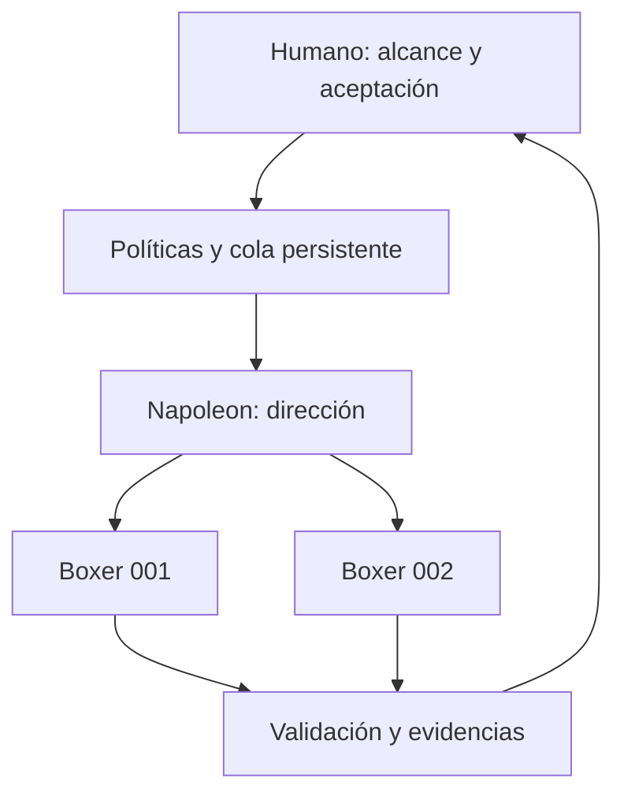
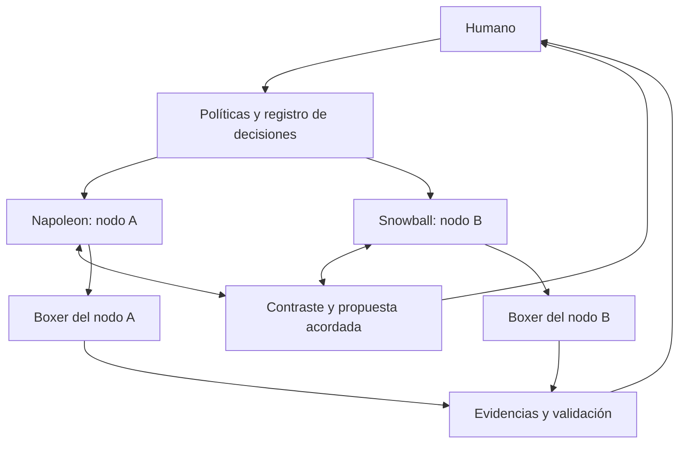

# Animal Farm: identidad y modelo de roles

Decisión de producto del promotor: 31 de octubre de 2026.

AgentFarm toma su nombre y sus personajes de *Animal Farm*, de George Orwell.
Los nombres identifican responsabilidades técnicas. La cooperación y las reglas
de acuerdo descritas aquí son una adaptación propia para AgentFarm, no una
afirmación de que los personajes cooperen así en la novela.

La [Orwell Foundation](https://www.orwellfoundation.com/the-orwell-foundation/orwell/books-by-orwell/animal-farm/)
presenta la obra como una sátira política. Esa dimensión inspira también la
trazabilidad del poder: decisiones visibles, políticas versionadas y derecho
a detener el trabajo cuando falten evidencias o recursos.

## Nombres estables

Se usan los nombres ingleses como identificadores técnicos, sin tildes:
`boxer`, `napoleon`, `snowball`. La interfaz futura podrá mostrar Boxer
(Boxeador), Napoleón y Bola de Nieve. Cada instancia tendrá un ID independiente,
por ejemplo `boxer-001`, `napoleon-01` o `snowball-02`.

Un rol no fija el proveedor, el modelo ni el equipo físico. Un Boxer podría
utilizar distintos adaptadores verificados; varios procesos en una máquina no
constituyen por sí solos varios nodos independientes ni revisiones independientes.

## Boxer: el trabajador

Máxima de identidad: **«Trabajaré más duro»** (*I will work harder*).

Recibe una tarea con alcance y base exactos, trabaja en un entorno aislado y
entrega un candidato con evidencias. No aprueba su propio trabajo, cambia las
políticas, amplía rutas permitidas ni recibe permisos para fusionar.

La máxima expresa perseverancia. Los presupuestos, los límites de revisión,
los plazos y la cancelación siguen siendo obligatorios; un Boxer debe parar y
explicar el bloqueo en vez de reintentar indefinidamente. El resultado del
trabajador se verifica fuera de su entorno antes de considerarse válido.

## Napoleon: una dirección

En la topología de un único nodo dirigente, una instancia Napoleon planifica
y asigna tareas a sus Boxer. El coordinador determinista conserva la autoridad
sobre estados, admisión y permisos; si Napoleon utiliza un LLM para planificar,
sus propuestas atraviesan esas mismas reglas.

Este esquema expresa la arquitectura objetivo, no procesos desplegados.

## Napoleon y Snowball: varias direcciones

Con varios nodos dirigentes se utiliza un consejo de instancias Napoleon y
Snowball. Cada dirigente puede coordinar Boxer locales. Se permiten varias
instancias de cada rol, con IDs únicos.

Napoleon enfatiza entrega, secuenciación y capacidad; Snowball enfatiza diseño,
alternativas y consecuencias arquitectónicas. Ambos pueden cuestionar una
propuesta y tienen el mismo peso. Son perspectivas de revisión, no niveles de
privilegio. Ningún Napoleon puede excluir a un Snowball o alterar el electorado.

### Protocolo propuesto para concretar después

1. Registrar una propuesta con ID y versión, SHA base, hash de especificación,
   versión de política y conjunto de dirigentes participantes.
2. Recoger posiciones y objeciones con sus evidencias. Una revisión de la
   propuesta produce otra versión e invalida los votos de la anterior.
3. Empezar con unanimidad del conjunto configurado. Con dos dirigentes, ambos
   deben aceptar la misma versión. Cambiar esa regla exige una política aprobada.
4. Limitar rondas y plazo de deliberación por política. Si hay desacuerdo,
   timeout o un nodo inaccesible, registrar el bloqueo y escalar al humano;
   no reducir el conjunto de votantes de forma implícita.
5. Registrar el acuerdo y su justificación. El acuerdo habilita una propuesta
   de trabajo dentro del alcance ya aprobado; no concede aprobación humana
   de alcance nuevo ni de integración. La aceptación final sigue ligada al
   commit candidato y a la especificación exacta.

Esto es **deliberación entre agentes**, no una implementación de consenso
distribuido. El transporte, la identidad de nodos, el registro consistente,
la recuperación, los leases y la prevención de doble asignación siguen
pendientes de diseño y pruebas. El SQLite actual solo coordina un nodo.

## Vocabulario del producto

La metáfora nombra cosas; las acciones y los estados usan palabras normales: el botón dice
«Aprobar», nunca «Moler». La interfaz muestra ambas palabras donde hace falta («Molinos ·
iniciativas») y la API y la base de datos conservan sus identificadores (`initiatives`, `work_items`).

| En la novela | En AgentFarm | Por qué encaja |
| --- | --- | --- |
| El molino | Iniciativa larga | Se levanta poco a poco, puede caer y se reconstruye con muros más gruesos: un fallo termina en una prueba de regresión |
| Los muros | Hito de un molino | Lo que queda en pie entre una etapa y otra |
| Las piedras | Tareas de un molino | Cada una se arrastra y se coloca por separado |
| La cosecha | Lo integrado en la semana | El resultado del trabajo |
| La reunión del domingo | Revisión semanal | La asamblea periódica en el granero |
| Los mandamientos del granero | [Los Siete Mandamientos](COMMANDMENTS.md) | Aquí nadie los repinta de noche |
| Benjamin | Revisión independiente | Sabe leer y no se deja engañar |
| Clover | Presupuesto | Le advierte a Boxer que no se exceda |
| Squealer | Lo que declara el agente | Da cifras favorables: «Squealer dice» es lo que aún nadie ha comprobado |

Reservados para más adelante, sin uso en la interfaz: cantera (backlog), tormenta (incidente),
Viejo Mayor (brief de una idea), Muriel (explicar en lenguaje llano), Mollie (trabajo fuera de
alcance) y Jones (regresiones). Hay que probar con usuarios si se entiende; unos seis términos
en la interfaz es el límite que nos ponemos.

*Rebelión en la granja* es de dominio público en Reino Unido y la UE, pero en Estados Unidos no lo
será hasta 2041. Antes de lanzar públicamente conviene una revisión legal, y no copiar frases de
traducciones publicadas.

## Ideas adicionales para valorar

Estas extensiones son sugerencias; no se activan ni se asignan permisos aquí.

| Nombre propuesto | Función posible | Resultado útil |
| --- | --- | --- |
| **Old Major** | Visión y principios del proyecto | Manifiesto humano versionado que los agentes pueden proponer cambiar. |

Benjamin evalúa un candidato sin modificarlo. Clover explica una parada; los límites
reales se imponen mediante código determinista. Old Major es documentación aprobada
por el humano, no un agente que pueda reescribir sus propias reglas. Un molino no
declara avance por contar tareas generadas o líneas de código.

## Estado y siguiente implementación

- Implementado en Java: simulador, alcance Git, presupuesto Clover y control
  plane local con registros, heartbeat y auditoría. [Migración](MIGRATION.md).
- Definido como identidad: Boxer, Napoleon, Snowball y ambas topologías.
- Propuesto: protocolo del consejo, supervisión completa de Clover y demás roles adicionales.
- Pendiente: trabajadores reales, aislamiento, adaptadores y comunicación entre nodos.

La siguiente entrega técnica sigue siendo un primer Boxer aislado bajo una
dirección Napoleon en un solo nodo. El consejo se añade después de verificar
cancelación, recuperación y ausencia de tareas duplicadas en ese nodo.
Este documento no modifica el esquema persistente ni el contrato de tareas.
