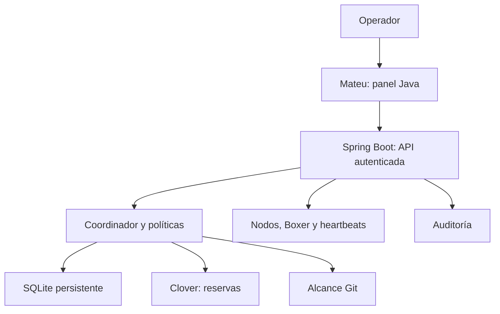

# Plan técnico — AgentFarm

Migración a Java con Spring Boot y control plane Mateu. Desarrollo en Ubuntu
24.04 LTS, distribución WSL Ubuntu. La migración se entrega en una PR; no
implica ejecución real de agentes ni despliegue productivo.

## Propósito y roles

Autonomía acotada, especificaciones versionadas y gobierno humano verificable.
Forja es el primer caso previsto, independiente del motor. Boxer es el trabajador;
Napoleon dirige un nodo; un consejo Napoleon/Snowball contrastará propuestas
cuando exista coordinación entre nodos. Clover controla admisión por presupuesto.
[Identidad y roles](ANIMAL_FARM.md).

## Arquitectura actual

Java 21, Boot 4.1.2, Mateu 3.0-beta.25 y SQLite JDBC. Un proceso sin SQL externo
ni frontend compilado por el usuario. Compose principal; JAR alternativo.
Mateu beta está fijado. Paquetes core, web y ui; la consola usa los mismos servicios.

## Contratos

TaskSpec conserva id, project, title, acceptance, allowed_paths y hash.
Los SQLite anteriores se importan sin recalcular hashes, consumos o reservas.
[Guía de migración](MIGRATION.md).

M1-001 verifica alcance de commits inmutables: altas/bajas, renombrados como
baja+alta, modos, symlinks, submódulos y rutas protegidas. Un pase solo acredita alcance.

M1-002 separa USD de API de cuota de suscripción. Para el promotor: máximo 50%
semanal de Codex. No se convierte la mensualidad en saldo API. Se comprueban
ventanas, reservas y observaciones atómicamente; ante incertidumbre se pausa.
Sin recargas ni fallback de pago. [Contrato](BUDGET.md).

## Gobierno

Cinco vistas Mateu: Bandeja, Tareas, Agentes, Presupuesto y Gobierno.
Sin heartbeat el estado es desconocido; tras 45 segundos caduca. El progreso
se identifica como declarado. Los cambios de gobierno se auditan.

Asignar exige tarea ready, nodo/Boxer habilitados y recientes, Boxer idle y
reserva de presupuesto. Hay máximo un trabajo assigned/running, dos cambios
en revisión y cinco ejecuciones/día. Assigned no significa proveedor ejecutado.

Pausar bloquea admisión. Cancelar ready conserva el registro cancelled; para
assigned/running se registra solicitud sin declarar proceso muerto ni coste cero.

## Seguridad y límites actuales

Autenticación de operador y protección de peticiones mutantes. Cookie HTTP-only
y SameSite. Las acciones Mateu exigen JSON del mismo origen local; la API
conserva CSRF de Spring. No hay contraseña universal ni secretos de proveedor.

El contenedor del control plane no monta proyectos ni socket Docker. Sus
límites no constituyen aislamiento de un trabajador. El futuro ejecutor estará
separado, con checkout temporal, red acotada, tiempos y cancelación verificados.

No hay transporte entre nodos, identidad por trabajador ni consenso distribuido.
La aprobación futura estará ligada al commit, especificación y política exactos.
La generación de propuestas o el progreso declarado no autoriza integración.
No hay fusión automática.

## Hitos

- M0: simulador, deduplicación, persistencia y contrapresión.
- M1-001: alcance Git, portado a Java.
- M1-002: presupuesto, portado a Java.
- M1-003: Java/Spring Boot/Mateu, instalación y control plane local.
- M1 siguiente: primer Boxer real aislado, login oficial, timeout/cancelación,
  consumo observado y tarea inocua en un repositorio de prueba.
- M2: evidencias, revisión independiente y aceptación humana para SHA exacto.
- M3: arquitectura As-Is/To-Be/transición enlazada a evidencias; integración
  no equivale a despliegue.
- M4: portabilidad de proyectos y proveedores verificados.
- M5: piloto medido, recuperación y posible coordinación multinodo.

ADR-001 motor independiente; ADR-002 un nodo inicial; ADR-003 políticas
deterministas; ADR-004 integración humana; ADR-005 separar intención/código/despliegue;
ADR-006 simulación hasta verificar aislamiento; ADR-007 Animal Farm;
ADR-008 Java/Spring Boot/Mateu y Compose por petición del promotor.

[Especificación M1-003](tasks/M1-003.md).

El historial de incrementos y autorizaciones está en [CHANGELOG](../CHANGELOG.md).
