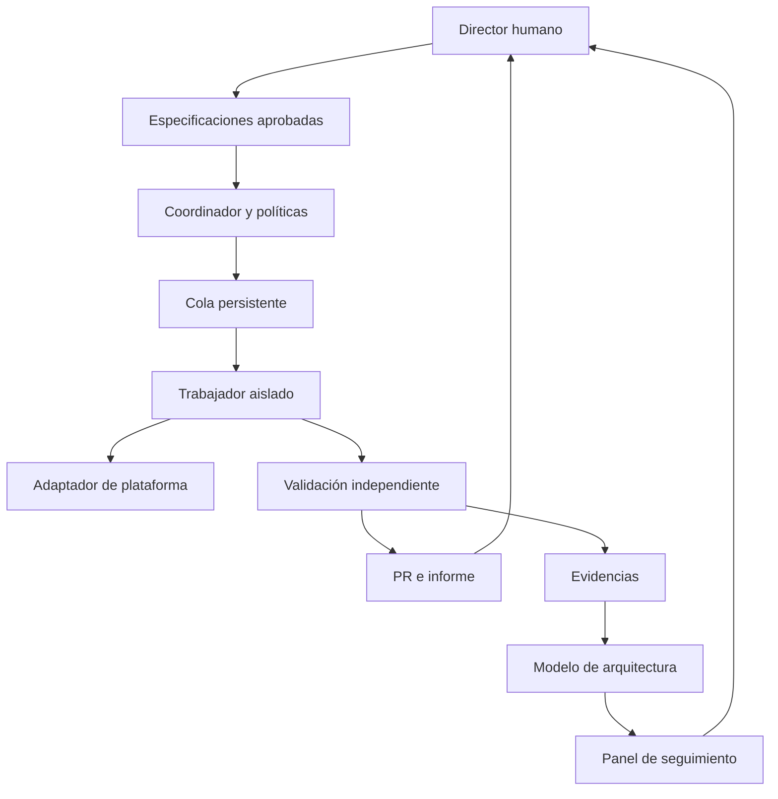

# Plan técnico — AgentFarm

Autor del proyecto: Alejandro Borrego Megías. Fecha: 31 de octubre de 2026.
Estado: propuesta de arquitectura y prototipo de coordinación simulado, pendiente de publicación en GitHub.

## 1. Problema y aportación

La generación de código puede superar la capacidad humana de comprender los cambios. Este proyecto busca mantener un equipo de agentes disponible para detectar problemas, proponer mejoras e implementar tareas aprobadas, sin perder el control de alcance, arquitectura, coste ni integración.

La unidad de progreso es un cambio comprendido y aceptado, no el número de líneas generadas. El sistema limita la producción a la capacidad de revisión humana y distingue siempre propuestas, código integrado y software desplegado.

Repositorio independiente y reutilizable para cualquier proyecto Git. Forja es un caso de validación, con gateway, knowledge layer, agentes y ML como dominios mencionados por el promotor, no como componentes cuya implementación hayamos inspeccionado. No hemos leído todavía su repositorio.

## 2. Filosofía: Spec-Driven Development

SDD significa desarrollo guiado por especificaciones. DDD, Domain-Driven Design, puede utilizarse para delimitar dominios y contratos; no son términos intercambiables.

Cada cambio sigue: propuesta → especificación → aprobación de alcance → implementación aislada → pruebas → revisión → aceptación humana → integración → observación del despliegue.

La especificación contiene ID y versión, problema, comportamiento esperado, exclusiones, componentes afectados, rutas permitidas, contratos, criterios observables, pruebas, límites, dependencias y reversión. Se calcula su hash y se liga a cada ejecución. Cambiarla invalida las aprobaciones anteriores.

Los agentes pueden crear propuestas de mantenimiento, pero no aprobarlas ni ampliar sus permisos. Las tareas especulativas quedan en `proposed`; solo las tareas aprobadas pasan a `ready`. Un cambio de API compartida, identidad, permisos, dependencias mayores o infraestructura necesita una decisión arquitectónica explícita.

## 3. Arquitectura objetivo

Coordinador determinista en Python; SQLite para un nodo. Las reglas de autorización y los estados nunca dependen de una decisión libre del LLM. Un proceso supervisor crea entornos temporales, impone tiempos y recoge resultados. Un publicador separado conserva el permiso de escritura en GitHub. Los trabajadores no reciben ese permiso ni pueden fusionar cambios.

Un solo trabajador activo inicialmente; implementación y revisión son roles, no dos máquinas obligatorias. Se pueden alternar plataformas. El revisor no debe modificar el parche que evalúa; si solicita reparaciones se genera otro commit y se repiten comprobaciones.

## 4. Separación entre motor y proyectos

El motor contiene coordinación, adaptadores, políticas, evidencias y visualización. Cada proyecto aporta su manifiesto: ruta del repositorio, rama base, comandos de pruebas, componentes, contratos, rutas permitidas y políticas aprobadas.

Las especificaciones de Forja viven en Forja. El motor guarda identificadores y hashes, no copias divergentes de su documentación. El primer piloto utiliza una tarea pequeña de un solo componente, después otra en un repositorio de ejemplo distinto para demostrar portabilidad.

## 5. Contratos y estado persistente

TaskSpec: `id`, `project`, `title`, `acceptance`, `allowed_paths`, `base_sha`, `spec_hash`, dependencias, límites y aprobación de alcance. El prototipo solo implementa los primeros cinco campos y el hash; los restantes se añaden antes de ejecución real.

Run: UUID, tarea, hash, plataforma/modelo/versión, modo de autenticación sin secretos, commit base, commit candidato, inicio/fin, estado y motivo de parada.

Evidence: hash del artefacto, productor, fecha, commit exacto, comando y código de salida. Los resultados que declara el trabajador se consideran no verificados hasta contrastarlos fuera de su entorno.

Estados objetivo: `proposed`, `ready`, `running`, `validating`, `review`, `blocked`, `accepted`, `merged`, `cancelled`. Fallo o timeout no equivale a tarea terminada. `merged` no implica `deployed`.

Adquisición atómica de tareas; clave de idempotencia por proyecto/tarea/hash; lease y heartbeat antes de distribuir nodos. Tras una caída se reconcilian proceso, rama y artefactos antes de reintentar. El prototipo conserva `running` y exige intervención en lugar de duplicar trabajo.

## 6. Control humano y límites

Valores iniciales propuestos: un trabajador, dos cambios pendientes de revisión, cinco ejecuciones al día, 30 minutos por tarea, dos reparaciones como máximo. Son valores de partida, no garantías de productividad.

La aprobación final se vincula a commit candidato, hash de especificación y versión de política. Un push posterior invalida la aprobación. La integración se serializa y exige revalidar sobre la base actual. El motor nunca interpreta un comentario del agente como aprobación humana.

El diff se compara con rutas permitidas y protegidas, incluyendo renombrados, archivos nuevos, borrados y enlaces simbólicos. Un incumplimiento bloquea la entrega. Estas comprobaciones detectan cambios; no sustituyen al aislamiento de ejecución.

Interruptor de parada: dejar de admitir trabajos y cancelar procesos con periodo de gracia. La revocación de autenticación es independiente. Las colas llenas, presupuesto agotado, autenticación vencida o incertidumbre de consumo detienen la admisión.

## 7. Entorno local y aislamiento

Primera plataforma prevista: Linux o Windows con WSL2. macOS requiere verificar el backend de contenedores. Antes de instalar se confirma sistema operativo, RAM y disco. No se requiere GPU para usar modelos alojados; el entrenamiento de Forja tendrá presupuesto propio.

Un usuario de sistema dedicado y un contenedor por tarea, sin privilegios, sin socket Docker, sin directorio personal montado, con CPU/RAM/PID/disco limitados. Solo se monta el checkout temporal. El controlador gestiona el runtime; el trabajador no lo controla. Un worktree por sí solo no es una frontera de seguridad.

La autenticación oficial de cada CLI se realiza en un entorno dedicado. No se copian indiscriminadamente sesiones del usuario. Las pruebas ejecutan código del proyecto en otro entorno sin credenciales de proveedor. Debe verificarse si las credenciales de una CLI son accesibles desde sus herramientas; no se promete aislamiento de secretos sin esa comprobación.

Salidas de red limitadas según necesidades. Sin acceso a producción. Repositorios e issues se tratan como datos no confiables: no pueden alterar políticas externas ni autorizar secretos. Logs privados con retención limitada y redacción; no publicar conversaciones completas por defecto.

## 8. Adaptadores de proveedores

Interfaz común prevista: `capabilities`, `preflight`, `run`, `cancel`, `normalize_result`. Cada adaptador declara soporte de ejecución no interactiva, streaming, timeout, cancelación, métricas, sandbox y autenticación.

Separar `provider`, `model` y `auth_mode`. Variables de entorno seleccionan opciones; no sustituyen el inicio de sesión oficial ni crean derechos de uso. No fallback silencioso de suscripción a API de pago. No rotar cuentas para evadir cuotas.

Codex: la documentación oficial consultada confirma `codex exec` y reutilización de autenticación guardada. Antes de habilitarlo, comprobar versión instalada, plan, login, permisos y ejecución mínima. Fuente: https://learn.chatgpt.com/docs/non-interactive-mode (consultada 31/10/2026).

Claude Code: adaptador planificado, pendiente de contrastar documentación oficial y probar con la cuenta real. Kimi y Antigravity: candidatos, no soporte confirmado. Una plataforma sin interfaz de automatización compatible queda como manual/experimental; no se emula su interfaz web para presentar soporte inexistente.

La compatibilidad se publica por combinación exacta de CLI/versión/autenticación, con fecha y prueba reproducible. Las suscripciones tienen cuotas; disponibilidad permanente no significa inferencia ilimitada.

## 9. As-Is, To-Be y transición

El modelo versionado de arquitectura es la fuente para las vistas. Componentes con ID estable, tipo, responsabilidad, propietario, relaciones, contratos y evidencias. Los nodos cloud incluyen proveedor, servicio, región y entorno solo cuando sean conocidos.

As-Is de código: lo comprobado en un SHA de la rama integrada. As-Is desplegado: observación de un entorno, versión y fecha. Si no se puede observar, se muestra `desconocido` o `desactualizado`, no se infiere a partir de un merge.

To-Be: objetivo aprobado y versionado con hitos. Los agentes proponen cambios; no lo reescriben para justificar una implementación divergente. Transición: componentes añadidos, modificados o retirados, enlazados a tarea, rama, PR y criterios pendientes.

Tres niveles: contexto del sistema; contenedores/servicios; detalle de un componente. Vista de despliegue separada para infraestructura. Las etiquetas distinguen planificado, en curso, integrado, desplegado, verificado y desconocido, además del color. Los iconos cloud son presentación; no evidencia.

Cada componente permitirá ver propósito, cambio actual, contratos, responsable, pruebas, commit, riesgos y decisión pendiente. El primer hito usa Mermaid estático; el panel interactivo llega después del modelo trazable. No se ha construido todavía.

La reconciliación combina manifiestos aprobados, diff, contratos y, cuando exista, inventario de infraestructura. Un LLM puede sugerir relaciones; no certificarlas. Una discrepancia crítica bloquea el cambio; otra no crítica se presenta explícitamente al humano.

## 10. Informes para entender los cambios

Informe por PR: problema; comportamiento antes/después; piezas tocadas y motivo; diagrama de transición; evidencia de cada criterio; riesgos; límites; reversión; decisiones que debe tomar el humano. Resumen comprensible primero y detalle enlazado después.

Cada afirmación técnica enlaza archivo y commit o resultado de prueba. Se distingue prueba no ejecutada, fallida y superada. La revisión de otro agente aporta evidencia adicional, no garantiza corrección.

Resumen periódico previsto: cambios integrados, trabajos en curso, decisiones bloqueadas, distancia al hito objetivo, consumo conocido/desconocido y capacidad de revisión restante. Solo se envía a destinos configurados expresamente por el usuario.

## 11. Costes

Inicio local: cero alquiler cloud, más electricidad y suscripciones existentes. Electricidad mensual = vatios medios / 1000 × horas × precio por kWh; medir consumo real. No presupuestar los portátiles como gratuitos ni repetir tarifas cloud anteriores sin verificarlas.

API opcional: reservar presupuesto antes de admitir una tarea, contabilizar consumo real y conciliar al terminar. Si el proveedor no permite una cota dura, documentar que es un límite de admisión aproximado y reservar margen. Para suscripciones registrar cuotas y bloqueos, no inventar coste por token.

## 12. Hitos y criterios de salida

M0 — documentación y simulador: cola persistente, deduplicación, límite de pendientes, informes honestos y pruebas. Entregado localmente en esta versión; pendiente de GitHub.

M1 — un trabajador real: aislamiento comprobado, login oficial, tarea pequeña en repositorio de prueba, timeout/cancelación y diff verificable. Ningún merge automático.

M2 — GitHub: especificación aprobada, PR, CI, revisión independiente y aceptación humana para SHA exacto. Demostrar bloqueo por cambio fuera de alcance y aprobación obsoleta.

M3 — arquitectura: modelo versionado, tres vistas, enlaces a evidencias y separación integrado/desplegado. Demostrar estado desconocido cuando falta observación.

M4 — portabilidad: mismo motor en Forja y otro repositorio con solo manifiestos diferentes; dos proveedores verificados donde sea posible.

M5 — operación continua: diez tareas piloto, recuperación tras caída, cuotas, coste por cambio aceptado y ausencia de duplicados. Solo entonces evaluar segundo portátil o VM.

## 13. Portfolio y publicación

Nota técnica: problema de pérdida de control; hipótesis; diseño; decisiones y alternativas; demostración reproducible; resultados; fallos; límites. Publicar diagramas y un ejemplo anonimizado de especificación → PR → pruebas → aprobación.

Medir tiempo humano de comprensión y revisión, proporción de cambios aceptados, desviaciones de alcance, defectos posteriores, reintentos, coste por cambio aceptado y fidelidad del mapa arquitectónico. Comparar tareas de dificultad similar y reportar tamaño de muestra. No utilizar líneas de código como prueba de calidad ni anunciar autonomía 24/7 antes de validarla.

## 14. Decisiones iniciales

ADR-001: motor separado de Forja para reutilización y demostrar desacoplamiento.
ADR-002: nodo local y un trabajador para limitar coste y facilitar depuración.
ADR-003: coordinación determinista y proveedores intercambiables.
ADR-004: integración humana y contrapresión según capacidad de revisión.
ADR-005: separar intención, código integrado y despliegue observado.
ADR-006: simulación explícita hasta validar aislamiento y credenciales reales.

## 15. Próximos pasos concretos

Crear repositorio privado `alejbormeg/AgentFarm` y subir esta base; verificar Forja y su documentación sin modificarlo; confirmar SO y memoria del portátil; completar M1 con una tarea inocua. La creación del repositorio está bloqueada actualmente por la autorización de autenticación del navegador, no por falta de acceso de lectura al conector GitHub.
